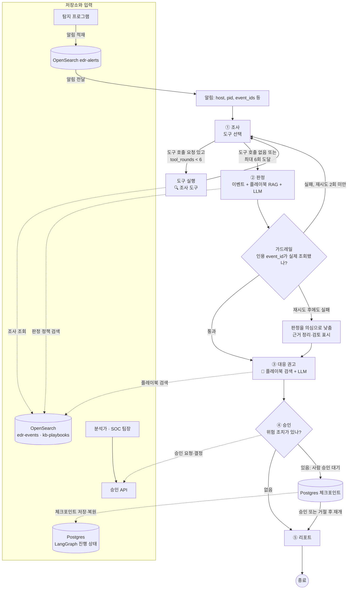
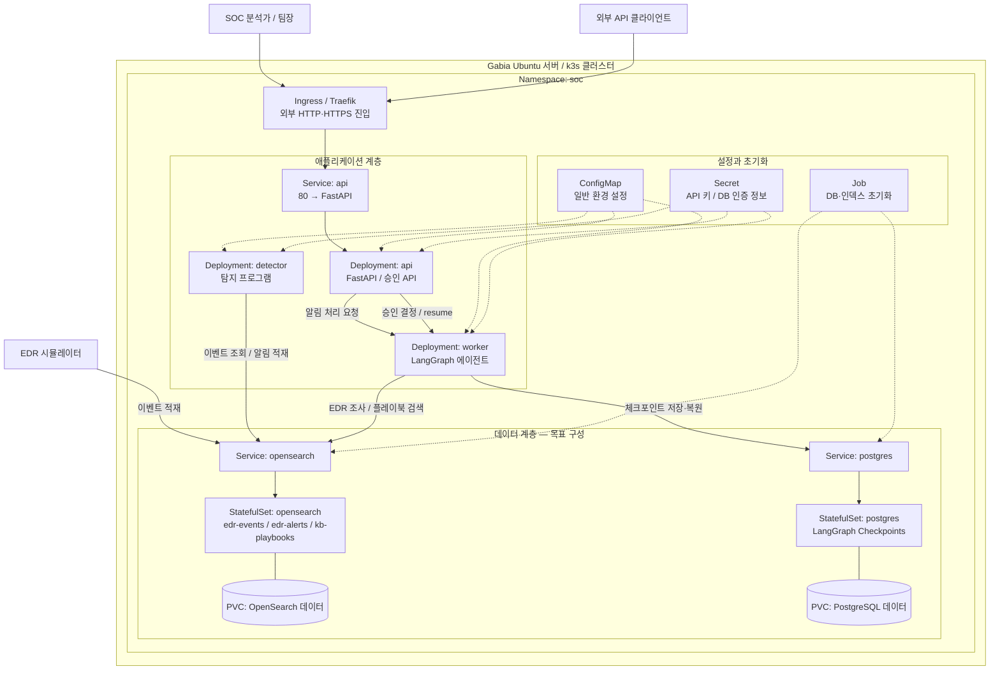

# 아키텍처

> 1일차 화이트보드 설계. 01 문서 5장의 ①~⑤ 흐름과 01b 문서의 부품 표를 실습 구조로 옮겼다. 아래는 설계도이며, 아직 구현하지 않은 동작은 표시했다.

## 1. 에이전트 설계도



| 노드 | 하는 일 | 읽는 상태 | 쓰는 상태 | 쓰는 도구 | 운전 |
|---|---|---|---|---|---|
| 조사 | 알림과 앞선 도구 결과를 보고 조사 도구를 더 부를지 정한다. | `alert`, `messages`, `tool_rounds` | `messages`, `trace`, `usage` | 🔍 조사 도구 선택 | 📘 |
| 도구 실행 | 요청된 도구를 실행해 결과를 대화에 넣고, 결과에서 조회한 `event_id`를 모은다. | `messages`, `alert` | `messages`, `seen_event_ids`, `tool_rounds`, `trace` | `get_process_tree`, `get_process_activity`, `get_host_timeline` | 📘 |
| 판정 | 실제 EDR 도구 결과와 플레이북 검색 결과의 정책 기준을 참고해 정상·의심·악성을 판정하고 신뢰도, ATT&CK 기법, 근거 ID를 만든다. | `alert`, `messages` | `verdict`, `judgment_sources`, `trace`, `usage` | 판정 LLM, 📘 `search_playbook` | 👥 |
| 가드레일 | 판정이 인용한 근거 ID가 실제 조회 기록 또는 알림 근거에 있는지 검증한다. | `verdict`, `seen_event_ids`, `alert`, `guardrail_retries` | `guardrail`, `guardrail_log`, 필요 시 `messages`, `guardrail_retries`, `verdict`, `trace` | 근거 검증 로직 | 👥 |
| 권고 | 판정과 알림을 바탕으로 플레이북을 찾고 대응 조치를 만든다. | `alert`, `verdict`, `messages` | `playbook`, `recommendation`, `trace`, `usage` | 📘 `search_playbook` | 🔍 |
| 승인 | 위험 조치가 포함됐는지 확인한다. 위험 조치는 사람의 결정을 기다리고, 위험하지 않으면 통과시킨다. | `recommendation`, `alert`, `verdict` | `approval`, `trace` | 승인 API / LangGraph interrupt | 🔍 |
| 리포트 | 판정, 근거, 판정·권고에 사용한 플레이북 출처, 승인 결과와 실행 경로를 모아 리포트를 만든다. | `alert`, `verdict`, `guardrail`, `guardrail_log`, `judgment_sources`, `recommendation`, `playbook`, `approval`, `tool_rounds`, `usage`, `trace` | `report`, `trace` | 리포트 저장·응답 경로 | 👥 |

### 상태에 담는 내용

LangGraph 상태는 각 노드가 공유하는 사건별 작업 기록이다. 사람이 승인하기 전 멈추더라도 같은 알림의 상태를 이어 쓸 수 있도록 Postgres 체크포인터에 저장한다.

| 상태 필드 | 담는 내용 |
|---|---|
| `alert` | 알림 ID, 시각, 호스트, 규칙, 심각도, 기법, 초기 이벤트 ID, PID |
| `messages` | 알림 입력, 조사 대화, 도구 호출과 반환 결과, 재조사 지시 |
| `seen_event_ids` | 조사 도구 결과에서 실제 확인한 이벤트 ID 목록 |
| `verdict` | 정상·의심·악성 판정, 신뢰도, ATT&CK 기법, 근거 이벤트 ID, 이유 |
| `judgment_sources` | 판정 시 정책 기준과 정상 업무 예외를 참고한 플레이북 출처 |
| `guardrail`, `guardrail_log`, `guardrail_retries` | 최근 검증 결과, 검증 이력, 재시도 횟수 |
| `playbook`, `recommendation` | 검색된 문서 조각과 출처, 대응 조치 및 요약 |
| `approval` | 승인 필요 여부, 승인·거절 결정, 승인자와 의견 |
| `trace` | 지나온 노드 경로 |
| `tool_rounds`, `usage` | 도구 실행 라운드 수와 모델 사용량 |
| `report` | 최종 판정·근거·권고·승인·출처를 정리한 결과 |

### 부품과 역할

| 01의 비유 | 실습의 부품 | 하는 일 |
|---|---|---|
| CCTV 녹화 | 시뮬레이터 | 가상 회사 PC의 활동 기록을 만든다. |
| 녹화 보관함 | OpenSearch `edr-events` | EDR 기록을 저장하고 검색한다. |
| 경보 규칙 | 탐지 프로그램 | 기록을 감시해 규칙에 맞는 알림을 만든다. |
| 경보함 | OpenSearch `edr-alerts` | 처리를 기다리는 알림을 저장한다. |
| 경비원 | 워커 (LangGraph 에이전트) | 알림을 가져와 조사·판정·권고를 수행한다. |
| 경비 매뉴얼 | OpenSearch `kb-playbooks` | PDF 플레이북·정책 청크를 검색한다. |
| 경비원의 수첩 | Postgres | 그래프 진행 상태를 체크포인트로 저장해 승인 후 이어서 처리한다. |
| 팀장의 승인 창구 | API | 분석가나 팀장이 리포트를 보고 승인·거절한다. |

## 2. 갈림길
<!-- 도구는 최대 몇 번 부르나? 가드레일이 실패하면? 승인은 언제 요청하나? -->
1. **조사 후 어디로 갈까?** 조사 LLM이 도구 호출을 요청하고 누적 실행 라운드가 6회 미만이면 도구 실행 후 다시 조사한다. 한 라운드에서 도구를 여러 개 요청할 수 있다. 도구 호출을 요청하지 않거나 6라운드에 도달하면 판정으로 넘어간다. 상한은 `MAX_TOOL_ROUNDS` 설정(기본값 6)을 따른다.
2. **가드레일이 실패하면?** 기본 설정은 `retry`다. 최대 두 차례 재조사를 요청해 근거를 보강한다. 두 번 재시도한 뒤에도 실패하면 근거로 확인되지 않은 ID를 제거하고, 악성 판정을 의심으로 낮추며 사람 검토가 필요하다고 표시한 뒤 권고 단계로 간다. 재시도 횟수는 `MAX_GUARDRAIL_RETRIES`(기본값 2), 정책은 `GUARDRAIL_ON_FAIL` 설정을 따른다.
3. **어떤 권고에서 멈출까?** `block_ip`, `kill_process`, `isolate_host`, `reset_password`처럼 정책상 위험한 조치가 있으면 승인 노드에서 멈춰 API를 통해 사람의 결정을 기다린다. 승인이 필요 없는 권고는 승인 대기 없이 리포트로 간다. 사람의 거절도 결과에 기록한 뒤 리포트로 이어진다.
4. **무엇을 근거로 제시할까?** 판정은 실제로 조사한 이벤트 ID만 인용한다. 판정 노드는 플레이북을 정책 맥락으로 참고하되 플레이북 청크를 EDR 이벤트 근거로 인용하지 않는다. 가드레일이 이벤트 ID를 검증하고, 리포트에는 이벤트 ID와 판정·권고에 사용한 플레이북 출처를 남긴다.

## 3. 배포 구성도 (2일차부터)

> 01b 문서 2장의 배포 구성을 Kubernetes 리소스(Deployment, StatefulSet, Job, Service, Ingress, Secret, ConfigMap, PVC)로 옮긴 설계도다.
>
> **상태 기준:** 현재 서버에 배포해 확인한 리소스와 향후 배포할 리소스를 구분한다. 설계도에 표시되어 있다고 해서 모두 구현 완료된 것은 아니다.

### 3-1. Kubernetes 전체 배포 구성도



**구성도 해석**

- 외부 사용자는 Ingress를 통해 FastAPI에 접근한다.
- FastAPI는 알림 조회, 분석 요청, 승인·거절, 리포트 조회를 담당한다.
- LangGraph Worker는 조사 → 판정 → 가드레일 → 권고 → 승인 → 리포트를 실행한다.
- OpenSearch는 EDR 이벤트, 탐지 알림, 플레이북 검색 데이터를 관리한다.
- PostgreSQL은 LangGraph의 체크포인트를 저장하여 승인 대기와 재개를 지원한다.
- StatefulSet과 PVC는 상태 저장 서비스의 데이터 영속성을 위한 목표 구성이다.
- ConfigMap은 일반 설정, Secret은 API 키와 데이터베이스 인증 정보를 관리한다.
- Job은 배포 과정에서 필요한 초기화를 수행한다.

**주의:** API와 Worker의 작업 전달 방식, 시뮬레이터의 이벤트 적재 경로, Ingress 접근 방식은 실제 구현 및 배포 설정에 따라 달라질 수 있다. 현재 구성도는 목표 아키텍처이며, 확인되지 않은 연결은 구현 완료로 간주하지 않는다.

### 3-2. Kubernetes 리소스별 역할

| Kubernetes 리소스 | 대상 | 역할 | 상태 |
|---|---|---|---|
| Namespace | `soc` | SOC 실습 리소스 분리 | 생성 확인 |
| Deployment | `api` | FastAPI 서비스 실행 | 배포 확인 |
| Service | `api` | API Pod로 요청 전달 | 생성 확인 |
| Deployment | `worker` | LangGraph 에이전트 실행 | 목표 |
| Deployment | `detector` | 탐지 프로그램 실행 | 목표 |
| StatefulSet | `opensearch` | EDR 로그·알림·플레이북 저장 | 목표 |
| StatefulSet | `postgres` | LangGraph Checkpoint 저장 | 목표 |
| Service | `opensearch` | OpenSearch 내부 통신 | 목표 |
| Service | `postgres` | PostgreSQL 내부 통신 | 목표 |
| PersistentVolumeClaim | OpenSearch / PostgreSQL | 데이터 영속 저장 | 목표 |
| Job | 초기화 작업 | DB 스키마·인덱스 초기화 | 목표 |
| ConfigMap | 공통 설정 | 일반 환경변수 설정 | 목표 |
| Secret | 인증 정보 | API 키·DB 비밀번호 관리 | 목표 |
| Ingress | Traefik | 외부 요청을 API에 전달 | 목표 |

### 3-3. 현재 서버 환경

| 항목 | 구성 |
|---|---|
| 서버 제공자 | Gabia |
| 운영체제 | Ubuntu |
| CPU | 4 vCPU |
| 메모리 | 15 GiB |
| 저장 공간 | 48 GB |
| Kubernetes | k3s v1.37.2+k3s1 |
| Namespace | `soc` |
| 애플리케이션 | FastAPI |
| Deployment | `api` |
| Service | `api`, Service Port 80 |
| 확인된 Pod 상태 | Ready 1/1 |
| 개발 접근 방식 | `kubectl port-forward` |
| OpenSearch | 로컬 Docker Compose에서 실습 |
| PostgreSQL | 로컬 Docker Compose에서 실습 |

현재 확인된 Kubernetes 배포 범위는 FastAPI Deployment 및 Service까지다.

OpenSearch와 PostgreSQL은 로컬 Docker Compose에서 사용하고 있으므로, Kubernetes 안의 StatefulSet으로 전환했다고 표시하지 않는다.

### 3-4. 로컬 개발 환경과 Kubernetes 환경 비교

| 구분 | 로컬 개발 | Kubernetes 목표 |
|---|---|---|
| 실행 방식 | Docker Compose / Python | k3s |
| FastAPI | 로컬 프로세스 또는 컨테이너 | Deployment |
| LangGraph | FastAPI 내부 실행 또는 로컬 실행 | Worker Deployment |
| OpenSearch | Docker Compose | StatefulSet + PVC |
| PostgreSQL | Docker Compose | StatefulSet + PVC |
| 서비스 연결 | localhost / Compose 네트워크 | Kubernetes Service |
| 외부 접근 | localhost | Ingress |
| 설정 관리 | `.env` | ConfigMap + Secret |
| 상태 복구 | PostgreSQL Checkpointer | PostgreSQL + PVC |

실습 서버는 4 vCPU, 15 GiB 메모리, 48 GB 디스크로 자원이 제한되어 있다. OpenSearch, PostgreSQL, FastAPI, Worker를 동시에 배포하기 전에 메모리와 저장 공간 사용량을 확인한다.

필요하면 상태 저장 서비스는 로컬 또는 별도 서버에서 먼저 운영하고, Kubernetes에는 API와 Worker부터 배포한다.

### 3-5. 배포 및 검증 순서

1. **클러스터 확인:** k3s와 `soc` Namespace의 상태를 점검한다.
2. **API 확인:** 기존 FastAPI Deployment, Service, Pod 상태를 점검한다.
3. **저장소 연결:** OpenSearch와 PostgreSQL에 접근할 수 있는지 확인한다.
4. **에이전트 배포:** LangGraph 실행 방식과 API 연동 방식을 확정한 뒤 Worker를 배포한다.
5. **체크포인트 확인:** PostgreSQL `PostgresSaver` 연결과 초기화를 검증한다.
6. **승인 연동:** 위험한 권고에서 `pending_approval` 상태로 멈추는지 확인한다.
7. **재시작 실험:** API 및 Worker를 재시작한 뒤 승인·거절로 재개되는지 확인한다.
8. **최종 검증:** `credential_dump` 알림을 처리해 최종 리포트에 실제 이벤트 ID와 승인 결과가 포함되는지 확인한다.

### 3-6. Kubernetes 점검 명령어

**현재 리소스 확인**

```bash
kubectl get nodes
kubectl get namespaces
kubectl get all -n soc
```

**API 확인**

```bash
kubectl get deployment api -n soc
kubectl get pods -n soc
kubectl get svc api -n soc
kubectl logs -n soc deployment/api --tail=100
```

**API 포트 포워딩**

```bash
kubectl port-forward -n soc svc/api 8000:80
```

**추가 배포 리소스 확인**

```bash
kubectl get statefulsets -n soc
kubectl get pvc -n soc
kubectl get jobs -n soc
kubectl get ingress -n soc
kubectl get configmaps -n soc
kubectl get secrets -n soc
```

Secret 목록에서 민감한 값 자체를 출력하거나 실습 기록에 복사하지 않는다.

### 3-7. 배포 완료 판정 기준

| 검증 항목 | 성공 조건 |
|---|---|
| API 접근 | API 요청에 정상 응답 |
| OpenSearch | 이벤트 및 플레이북 검색 성공 |
| PostgreSQL | 체크포인트 저장·조회 성공 |
| LangGraph | 알림을 입력받아 조사부터 리포트까지 실행 |
| 근거 추적 | 판정 근거에 실제 `event_id` 포함 |
| 가드레일 | 허위 근거 차단 및 악성 판정 최소 근거 수 검증 |
| 승인 대기 | 위험 권고 발생 시 `pending_approval` |
| 승인 재개 | 승인 후 `completed` |
| 승인 거절 | 거절 결과가 리포트에 기록 |
| 재시작 복구 | API / Worker 재시작 후 기존 승인 대기 상태 복구 |
| 데이터 영속성 | 저장소 Pod 재시작 후 데이터 보존 |

**배포 완료 여부는 각 조건을 실제 환경에서 실행하고 결과를 확인한 후 기록한다.**

현재 전체 Python 테스트는 `19 passed`이지만, 이것만으로 Kubernetes 배포, PostgreSQL 재시작 복구, Dify 실제 연동까지 검증된 것은 아니다.
