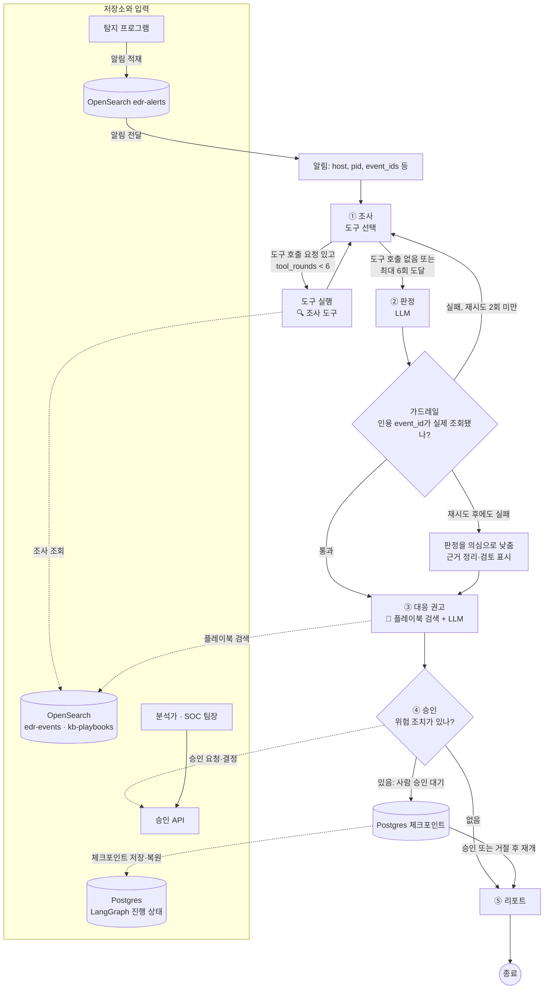

# 아키텍처

> 1일차 화이트보드 설계. 01 문서 5장의 ①~⑤ 흐름과 01b 문서의 부품 표를 실습 구조로 옮겼다. 아래는 설계도이며, 아직 구현하지 않은 동작은 표시했다.

## 1. 에이전트 설계도

| 노드 | 하는 일 | 읽는 상태 | 쓰는 상태 | 쓰는 도구 | 운전 |
|---|---|---|---|---|---|
| 조사 | 알림과 앞선 도구 결과를 보고 조사 도구를 더 부를지 정한다. | `alert`, `messages`, `tool_rounds` | `messages`, `trace`, `usage` | 🔍 조사 도구 선택 | 📘 |
| 도구 실행 | 요청된 도구를 실행해 결과를 대화에 넣고, 결과에서 조회한 `event_id`를 모은다. | `messages`, `alert` | `messages`, `seen_event_ids`, `tool_rounds`, `trace` | `get_process_tree`, `get_process_activity`, `get_host_timeline` | 📘 |
| 판정 | 도구 결과를 근거로 정상·의심·악성을 판정하고 신뢰도, ATT&CK 기법, 근거 ID를 만든다. | `alert`, `messages` | `verdict`, `trace`, `usage` | 판정 LLM | 👥 |
| 가드레일 | 판정이 인용한 근거 ID가 실제 조회 기록 또는 알림 근거에 있는지 검증한다. | `verdict`, `seen_event_ids`, `alert`, `guardrail_retries` | `guardrail`, `guardrail_log`, 필요 시 `messages`, `guardrail_retries`, `verdict`, `trace` | 근거 검증 로직 | 👥 |
| 권고 | 판정과 알림을 바탕으로 플레이북을 찾고 대응 조치를 만든다. | `alert`, `verdict`, `messages` | `playbook`, `recommendation`, `trace`, `usage` | 📘 `search_playbook` | 🔍 |
| 승인 | 위험 조치가 포함됐는지 확인한다. 위험 조치는 사람의 결정을 기다리고, 위험하지 않으면 통과시킨다. | `recommendation`, `alert`, `verdict` | `approval`, `trace` | 승인 API / LangGraph interrupt | 🔍 |
| 리포트 | 판정, 근거, 플레이북 출처, 권고, 승인 결과와 실행 경로를 모아 리포트를 만든다. | `alert`, `verdict`, `guardrail`, `guardrail_log`, `recommendation`, `playbook`, `approval`, `tool_rounds`, `usage`, `trace` | `report`, `trace` | 리포트 저장·응답 경로 | 👥 |

### 상태에 담는 내용

LangGraph 상태는 각 노드가 공유하는 사건별 작업 기록이다. 사람이 승인하기 전 멈추더라도 같은 알림의 상태를 이어 쓸 수 있도록 Postgres 체크포인터에 저장한다.

| 상태 필드 | 담는 내용 |
|---|---|
| `alert` | 알림 ID, 시각, 호스트, 규칙, 심각도, 기법, 초기 이벤트 ID, PID |
| `messages` | 알림 입력, 조사 대화, 도구 호출과 반환 결과, 재조사 지시 |
| `seen_event_ids` | 조사 도구 결과에서 실제 확인한 이벤트 ID 목록 |
| `verdict` | 정상·의심·악성 판정, 신뢰도, ATT&CK 기법, 근거 이벤트 ID, 이유 |
| `guardrail`, `guardrail_log`, `guardrail_retries` | 최근 검증 결과, 검증 이력, 재시도 횟수 |
| `playbook`, `recommendation` | 검색된 문서 조각과 출처, 대응 조치 및 요약 |
| `approval` | 승인 필요 여부, 승인·거절 결정, 승인자와 의견 |
| `trace` | 지나온 노드 경로 |
| `tool_rounds`, `usage` | 도구 실행 라운드 수와 모델 사용량 |
| `report` | 최종 판정·근거·권고·승인·출처를 정리한 결과 |

### 부품과 역할

| 01의 비유 | 실습의 부품 | 하는 일 |
|---|---|---|
| CCTV 녹화 | 시뮬레이터 | 가상 회사 PC의 활동 기록을 만든다. |
| 녹화 보관함 | OpenSearch `edr-events` | EDR 기록을 저장하고 검색한다. |
| 경보 규칙 | 탐지 프로그램 | 기록을 감시해 규칙에 맞는 알림을 만든다. |
| 경보함 | OpenSearch `edr-alerts` | 처리를 기다리는 알림을 저장한다. |
| 경비원 | 워커 (LangGraph 에이전트) | 알림을 가져와 조사·판정·권고를 수행한다. |
| 경비 매뉴얼 | OpenSearch `kb-playbooks` | PDF 플레이북·정책 청크를 검색한다. |
| 경비원의 수첩 | Postgres | 그래프 진행 상태를 체크포인트로 저장해 승인 후 이어서 처리한다. |
| 팀장의 승인 창구 | API | 분석가나 팀장이 리포트를 보고 승인·거절한다. |

## 2. 갈림길
<!-- 도구는 최대 몇 번 부르나? 가드레일이 실패하면? 승인은 언제 요청하나? -->
1. **조사 후 어디로 갈까?** 조사 LLM이 도구 호출을 요청하고 누적 실행 라운드가 6회 미만이면 도구 실행 후 다시 조사한다. 한 라운드에서 도구를 여러 개 요청할 수 있다. 도구 호출을 요청하지 않거나 6라운드에 도달하면 판정으로 넘어간다. 상한은 `MAX_TOOL_ROUNDS` 설정(기본값 6)을 따른다.
2. **가드레일이 실패하면?** 기본 설정은 `retry`다. 최대 두 차례 재조사를 요청해 근거를 보강한다. 두 번 재시도한 뒤에도 실패하면 근거로 확인되지 않은 ID를 제거하고, 악성 판정을 의심으로 낮추며 사람 검토가 필요하다고 표시한 뒤 권고 단계로 간다. 재시도 횟수는 `MAX_GUARDRAIL_RETRIES`(기본값 2), 정책은 `GUARDRAIL_ON_FAIL` 설정을 따른다.
3. **어떤 권고에서 멈출까?** `block_ip`, `kill_process`, `isolate_host`, `reset_password`처럼 정책상 위험한 조치가 있으면 승인 노드에서 멈춰 API를 통해 사람의 결정을 기다린다. 승인이 필요 없는 권고는 승인 대기 없이 리포트로 간다. 사람의 거절도 결과에 기록한 뒤 리포트로 이어진다.
4. **무엇을 근거로 제시할까?** 판정은 실제로 조사한 이벤트 ID만 인용한다. 가드레일이 근거를 검증하고, 리포트에는 이벤트 ID와 플레이북 출처를 남긴다.

## 3. 배포 구성도 (2일차부터)
<!-- 01b 문서 2장의 그림을 실제 리소스(Deployment, StatefulSet, Job, Service, Ingress, Secret, ConfigMap)로 바꿔 그리기 -->
